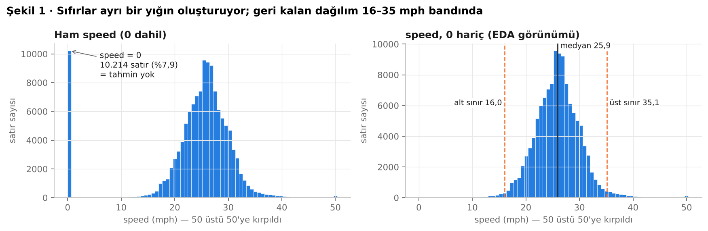
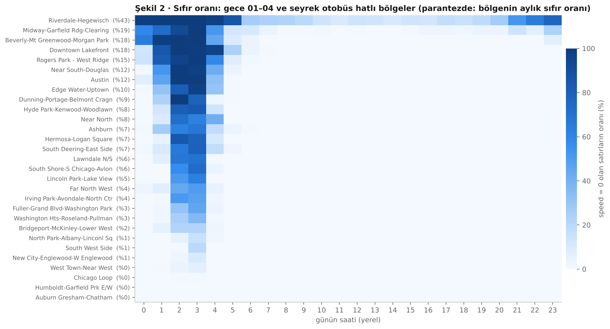
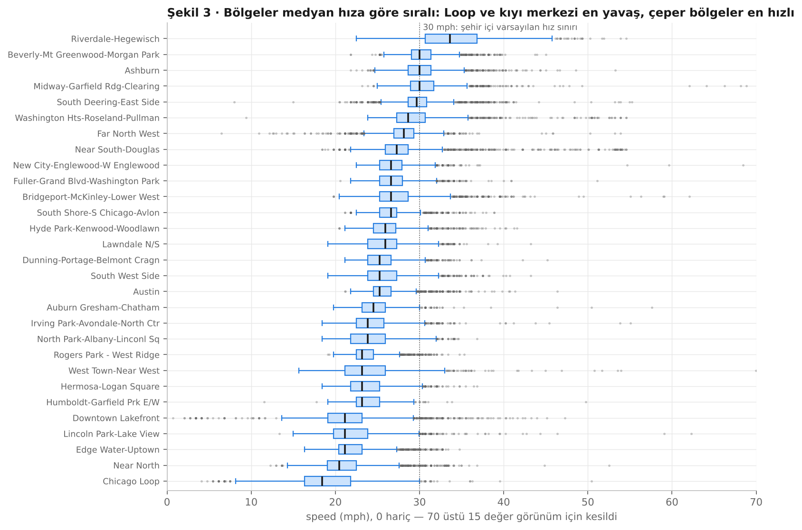
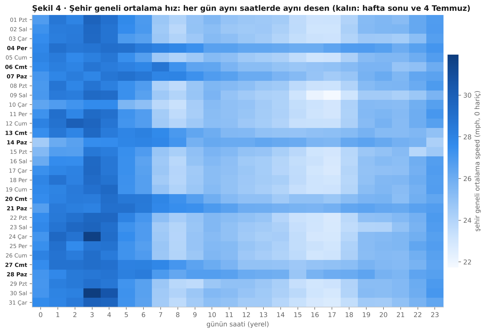
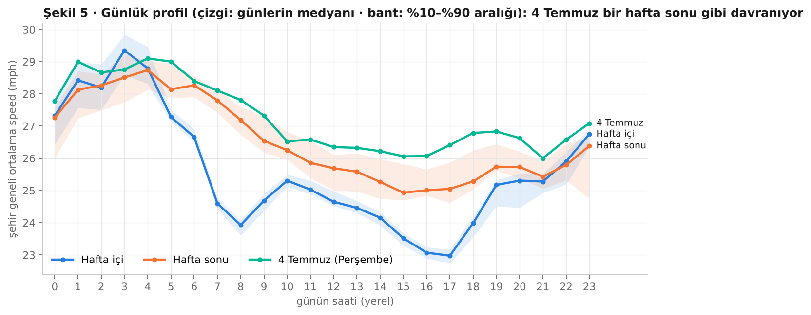
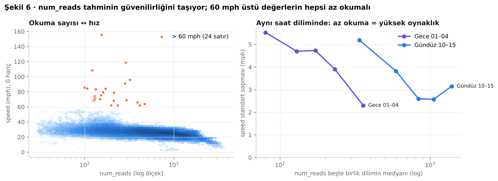
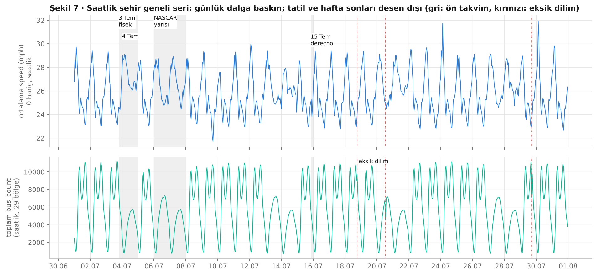
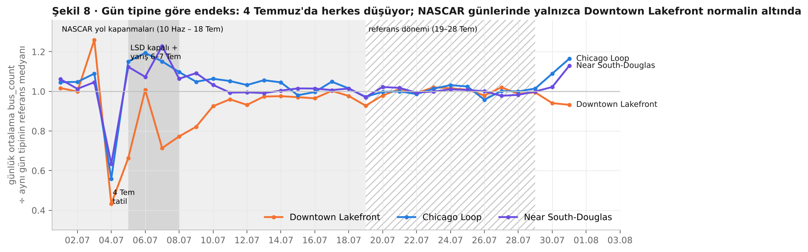
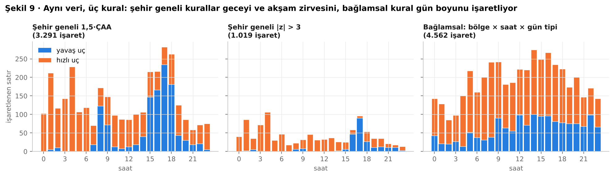

# 2 · Veri Anlayışı (H2)

**BSM 429 Veri Madenciliği · Dönem Projesi · Proje l — Otopark ve trafik yoğunluğu · Varyant l3 — Olay tespiti**
Veri: Chicago Traffic Tracker — Historical Congestion Estimates by Region · **Temmuz 2024** · Defter: [`notebooks/02_veri_anlayisi.ipynb`](../notebooks/02_veri_anlayisi.ipynb)

> Dayanak: H02 (veri sözlüğünün dört sorusu · dört ölçek türü · altı kalite boyutu · beş sayı özeti ve 1,5·ÇAA · grafik kataloğu) ve H03 (eksik değer kılıkları, aykırı değer karar soruları). Bu bölümdeki her sayı defterin çıktısıdır; toplu hâli [`outputs/bulgular.json`](../outputs/bulgular.json) dosyasında. Bu adım veriyi **ölçer ve belgeler**; hiçbir satırı silmez, hiçbir değeri doldurmaz. Eksik ve aykırı değer **kararları** 3. adımın (H3), anomali tespiti 8. adımın (H11) işidir.

---

## 2.1 Veri kümesi seçimi ve neden bu veri

| Soru | Cevap |
|---|---|
| Kaynak | City of Chicago Veri Portalı, `kf7e-cur8` — veri sahibi Chicago Department of Transportation (CDOT) |
| Nasıl üretiliyor | CTA otobüslerinin GPS izlerinden, arter (otoyol dışı) yollar için **10 dakikada bir** bölge bazında tıkanıklık tahmini |
| Birim | 29 bölge × 10 dakikalık zaman dilimi — bir satır = bir bölgenin bir dilimdeki tahmini |
| Kesit | 1–31 Temmuz 2024 · **129.311 satır × 17 sütun** · 33,3 MB (repo içinde gzip: 2,2 MB) |
| Neden bu veri | Katalogdaki proje l'nin önerilen verisi; aylık kesit yeterli büyüklükte; zaman sıralı ve bölge bazında — l3'ün "olağandışı saat" sorusu için doğal birim |

**Anatomi (H02 §1, §3).**

| Yapı | Bu veride |
|---|---|
| Kayıt (satır) | Bir bölgenin bir 10 dakikalık dilimdeki tıkanıklık tahmini — 29 bölge × 4.459 dilim = 129.311 kayıt |
| Öznitelik (sütun) | 17 → boyut 17. `time` + `region_id` kaydın anahtarı; 6'sı bölge başına sabit (ad, tarif, 4 koordinat), 2'si koordinatların tekrarı, 3'ü `time`'dan türetilmiş, 1'i kayıt kimliği. **Ölçüm taşıyan yalnızca 3 sütun:** `speed`, `bus_count`, `num_reads` |
| Hedef sütun | **Yok.** l3 etiketsiz bir anomali problemi; 5. adımın sınıflandırma hedefi `speed`'den türetilecek (3. adım) |
| Biçim | Yapılandırılmış (CSV) |
| Veri kümesi türü | **Sıralı veri (zaman serisi)** — kayıtlar bağımsız değil; bölme ve doğrulama bunu hesaba katmak zorunda |

**Ne ölçüyoruz? (H02 vaka notu — Google Grip Eğilimleri'nin sorusu)**

| | `speed` |
|---|---|
| Ölçtüğünü sandığımız | Bölgedeki trafiğin ortalama hızı |
| Gerçekte ölçtüğü | O 10 dakikada bölgeden geçen **CTA otobüslerinin** GPS izlerinden hesaplanan bir tıkanıklık göstergesi — yeterli okuma varsa |
| Aradaki bağ | Bir varsayım: otobüs trafikle birlikte akar. Duraklar, otobüs şeritleri ve sefer sıklığı bu bağı gevşetir |
| Bağın koptuğu yerler | Gece (otobüs az → tahmin yok ya da oynak) · olay günlerinde güzergâh değişince (§2.6, Şekil 8) |

Bu tablo 8. adımın yorumunu baştan sınırlar: bulunan bir "anomali" trafikte değil, **ölçüm aracında** da olabilir.

**Neden Temmuz 2024?** l3'ün çıktısı bir *doğrulama anlatısı*: bulunan anomalilerin takvimde bir karşılığı olmalı. Temmuz 2024 bu açıdan zengin ve temiz bir aydır:

- **Takvim olayları yoğun:** 4 Temmuz resmî tatili (Perşembe); 3 Temmuz Navy Pier havai fişekleri; NASCAR Chicago Street Race (yarış 6–7 Temmuz, yol kapanmaları 10 Haziran–18 Temmuz); 9–10 Temmuz Beryl kalıntılarının yağışı; 14 Temmuz gece fırtınası; 15 Temmuz derecho (NWS Chicago bölgesinde tek günde rekor sayıda hortum); ay sonunda Lollapalooza kapanmaları; Cubs ve White Sox iç saha maçları (§2.9).
- **Yaz saati geçişi yok:** 2024'teki geçişler 10 Mart ve 3 Kasım'daydı. Veride de doğrulandı (`record_id` − `time` farkı ay boyunca sabit 5 saat) — tekrar eden ya da kaybolan saat yok.
- **Sınırı:** varyantın saydığı olay türlerinden **kar fırtınası bu ayda olamaz.** "Hava olayı" kategorisini yağış, fırtına ve derecho dolduruyor. Bu, rapordaki sınırlılıklar bölümüne yazılmalı.

## 2.2 Veriyi alma ve bütünlük kontrolü

Portalın "Export" düğmesi 10,8 milyon satırın tamamını vermeye çalıştığı için, katalogdaki öneriye uyarak yalnızca Temmuz penceresi Socrata API'siyle çekildi:

```
https://data.cityofchicago.org/resource/kf7e-cur8.csv
   ?$where=time between '2024-07-01T00:00:00' and '2024-08-01T00:00:00'
   &$limit=250000
```

| Kontrol | Sonuç |
|---|---|
| `$limit` kesmesi oldu mu? | Hayır — 129.311 < 250.000 |
| `between` üst sınırı da kapsar: 1 Ağustos 00:00'dan sızan satır var mı? | Yok (0 satır); defter yine de filtreliyor |
| İlk / son zaman damgası | 2024-07-01 00:01:13 → 2024-07-31 23:50:27 |
| MD5 (ham CSV) | `2e14c914cc5ce10d1d4ce42c039ee41c` — tekrarlanabilirlik için |

## 2.3 Veri sözlüğü

H02 §1.1'in dört sorusu, her sütun için: **ne ölçüyor** (tam bir cümleyle) · **birimi** · **ölçek türü** · **eksik nasıl işaretlenmiş**. Son sütun H02 §2.5'in merdiveninden: o ölçek türünde hangi özet anlamlı. Tam tablo (benzersiz değer sayısı ve değer aralığıyla): [`outputs/veri_sozlugu.csv`](../outputs/veri_sozlugu.csv).

| Sütun | Ne ölçüyor | Birim | Ölçek türü | Eksik nasıl işaretlenmiş | Anlamlı özet |
|---|---|---|---|---|---|
| `time` | Bölgenin tıkanıklık tahmininin üretildiği tarih ve saattir. | tarih-saat, **yerel** (CDT = UTC−5) | aralık | Boş hücre yok. **Örtük eksik:** 5 zaman dilimi tümüyle yok → 145 satır hiç gelmemiş | Fark, sıralama |
| `region_id` | Kaydın ait olduğu trafik bölgesinin keyfî numarasıdır (1–29). | — | **nominal** | Yok | Mod, frekans — ortalaması anlamsız |
| `speed` | Bölgedeki arter yolların o 10 dakikadaki tahmini **tıkanıklık düzeyidir**; mph cinsinden yazılır ama gerçek ortalama araç hızı değildir. | mph; çözünürlük ≈ 0,68 mph (1 ft/sn) | oran | **Sıfır kılığı:** `bus_count < 5` veya `num_reads < 30` olduğunda **0** yazılır — 10.214 satır (%7,9). NaN yok | Hepsi (0'lar hariç tutularak) |
| `region` | Trafik bölgesinin adıdır; her bölge benzer trafik desenli 2–3 topluluk alanını birleştirir. | — | nominal | Yok · yazım: *Linconl, Cragn, Prk, Avlon* | Mod, frekans |
| `bus_count` | O 10 dakikada bölgedeki tahmini üretmek için kullanılan otobüs sayısıdır. | adet | oran | Yok. **0 gerçek sıfırdır** (394 satır: o dilimde otobüs yok) | Hepsi |
| `num_reads` | O 10 dakikada tahmin için alınan (kullanılan) GPS okumalarının sayısıdır. | adet | oran | Yok. 0 gerçek sıfırdır (aynı 394 satır) | Hepsi |
| `hour` | Kaydın günün hangi saatine düştüğüdür; `time`'dan türetilmiştir. | 0–23 | aralık (döngüsel) | Yok · artık sütun | Frekans, fark — düz ortalama yanıltıcı |
| `day_of_week` | Kaydın haftanın hangi gününe düştüğüdür; `time`'dan türetilmiştir. | **Pazar = 1** … Cumartesi = 7 | aralık (döngüsel) | Yok · ⚠️ pandas'ta Pazartesi = 0 | Frekans — düz ortalama anlamsız |
| `month` | Kaydın ayıdır; `time`'dan türetilmiştir. | 1–12 | aralık (döngüsel) | Yok · bu kesitte sabit (7) | — |
| `description` | Bölgenin sınırlarını cadde adlarıyla tarif eden metindir. | — | nominal | Yok · yazım: *Roosevel, Diversy, Halem, Steward/Stewart* | — |
| `record_id` | Kaydın benzersiz kimliğidir: bölge numarası + **UTC** zaman (`BB-YYYYMMDDHHMM`). | — | nominal (tanımlayıcı) | Yok · benzersiz | — |
| `west`, `east` | Bölgeyi çevreleyen dikdörtgenin batı/doğu kenarının yaklaşık boylamıdır. | derece | aralık | Yok · bölge başına sabit | — |
| `south`, `north` | Bölgeyi çevreleyen dikdörtgenin güney/kuzey kenarının yaklaşık enlemidir. | derece | aralık | Yok · bölge başına sabit | — |
| `nw_location`, `se_location` | Dikdörtgenin köşe noktalarıdır, WKT `POINT (boylam enlem)`. | derece | nominal (geometri) | Yok · `west/north` ve `east/south`'un **tekrarı** | — |

**Ölçek türü kararlarının gerekçesi** (H02'nin iki kontrolü — *"sıfır gerçek bir yokluk mu?"* ve *"iki değeri toplamanın anlamı var mı?"*): `speed`, `bus_count`, `num_reads` → 0 gerçek yokluk (hareket yok / otobüs yok / okuma yok) → **oran**. `time`, `hour`, `day_of_week`, `month` → aralıklar eşit, başlangıç seçilmiş (gece yarısı, Pazar = 1) → **aralık**, üstelik döngüsel. Boylam/enlem → sıfırı Greenwich/ekvator, tıpkı rakım gibi → **aralık**. `region_id`, `record_id` → sayı ya da kod kılığında ad → **nominal**.

> 📌 Portalın şemasında `Community Areas`, `Zip Codes`, `Wards` adlı üç *hesaplanmış* sütun daha var; CSV uç noktası bunları vermiyor ve bu projede gerekmiyor.

**🧭 Tuzak Köşesi — `describe()` neyi bilmez? (H02)** pandas sayı gördüğü her sütunun ortalamasını hesaplar: `region_id`'nin ortalaması **15**, `day_of_week`'inki **3,9**, `hour`'unki **11,5** çıkıyor — üçü de anlamsız ("ortalama posta kodu" hatası). Doğru özet frekans: 29 bölgenin her birinde tam 4.459 kayıt. Gün frekansı ise işe yarar bir şey söylüyor: Temmuz 2024 pazartesi başlayıp çarşamba bittiği için **pazartesi, salı ve çarşamba 5'er kez**, diğer günler 4'er kez var (20.822–20.880 ↔ 16.646–16.704 kayıt). Gün bazlı ortalamalar bu dengesizlikten etkilenir; 4 Temmuz da bir perşembeyi tatile çeviriyor.

## 2.4 Sütun incelemesinin bulguları

**`isna().sum()` = 0 — ama veri eksiksiz değil.** H03'ün uyarısı bu veride birebir geçerli: *en tehlikeli eksik, eksik gibi görünmeyendir.*

| # | Bulgu | Kanıt |
|---|---|---|
| 1 | **`speed = 0` bir ölçüm değil, "tahmin yok" işaretidir.** Kural kusursuz: `speed > 0` ⟺ `bus_count ≥ 5` **ve** `num_reads ≥ 30`. Portal belgesi bunu söylemiyor; veriden çıkarıldı | 2×2 çapraz tabloda köşegen dışı hücreler 0 / 0 |
| 2 | **Örtük eksik:** 5 zaman diliminde 29 bölgenin hepsi yok (18 Tem 17:50 · 20 Tem 13:00–13:10 · 29 Tem 17:00–17:10) — sistem kesintisi | Beklenen 4.464 dilim, gelen 4.459 · beklenen 129.456 satır, gelen 129.311 |
| 3 | **İki saat dilimi:** `time` yerel saat, `record_id` UTC | Fark her satırda tam 300 dk |
| 4 | Bölgeler aynı dilimde birkaç saniye farkla yazılıyor; ham `time` ile birleştirme yapılamaz | 5.140 farklı damga, 4.459 dilim · gecikme 3–107 sn |
| 5 | `hour`, `day_of_week`, `month` `time` ile %100 tutarlı → yeni bilgi taşımıyor | — |
| 6 | Her `region_id`'ye tek ad, tarif ve dikdörtgen; mükerrer satır yok | 0 mükerrer bölge × dilim |
| 7 | Hız 1 ft/sn'lik (0,68 mph) ızgarada üretiliyor; daha küçük farklar çözünürlüğün altında | Geçerli değerlerin %87'si ızgarada |
| 8 | `bus_count` ve `num_reads` **güvenilirlik sütunlarıdır**; birbirleriyle çok güçlü ilişkili | r = 0,95 · saat 02–03'te medyan 4 otobüs, 16:00'da 54 |
| 9 | Metin sütunlarında 11 yazım/tutarlılık sorunu (analizi bozmaz) | `region`'da 4, `description`'da 7 |
| 10 | Okuma sayısı arttıkça hız düşüyor; ilişkinin bir kısmı **saat** gibi bir gizli değişkenden, bir kısmı muhtemelen ölçümün kendisinden geliyor (aşağıda) | r(speed, num_reads) = −0,54 |

**Korelasyon ve gizli değişken (H02 §9).** H02'nin üç ihtimali bu veride:

| İhtimal | Bu veride | Kanıt |
|---|---|---|
| **C ikisine birden sebep (gizli değişken)** | **Saat ve bölge.** Yoğun saatte hem sefer çok (okuma ↑) hem trafik yoğun (hız ↓); Loop'ta hem otobüs çok hem hız düşük | Yalnız saat 03'e bakınca ilişki neredeyse kayboluyor: r = −0,13 |
| B, A'ya sebep (hız → okuma) | Yavaş trafikte otobüs bölgede daha uzun kalır → 10 dakikada **daha çok GPS okuması** üretir | Saat 14'te, **aynı bölge içinde** bile ilişki sürüyor: ortalama r = −0,44 |
| A, B'ye sebep (okuma → hız) | Okuma sayısının hızı değiştirmesi için bir mekanizma yok | — |

İkinci satır bir **hipotezdir**; CDOT'un yöntem belgesi olmadığı için doğrulanamadı. Doğruysa `num_reads` yalnızca güvenilirlik değil, kısmen **hızın yan ürünüdür** — aynı dilimin hızını tahmin eden bir modelde öznitelik yapılırsa hedefin bir yansımasını modele vermek olur (H03 §7.2). H02'nin kuralı: *mekanizmasını cevaplayamıyorsanız "bilmiyorum" diye yazın.*

## 2.5 Özet istatistikler ve beş sayı özeti

`speed`'in istatistiği iki kez hesaplandı: **ham** ve **sıfırlar hariç** (yalnızca EDA görünümü — bir doldurma ya da silme kararı değildir).

| Değişken | min | Q1 | medyan | Q3 | maks |
|---|---|---|---|---|---|
| `speed` (ham, 0 dahil) | 0,00 | 22,36 | 25,23 | 27,95 | 155,80 |
| `speed` (0 hariç, n = 119.097) | 0,68 | 23,18 | 25,91 | 27,95 | 155,80 |
| `bus_count` | 0 | 14 | 30 | 48 | 230 |
| `num_reads` | 0 | 274 | 576 | 958 | 3.717 |

| | `speed` ham | `speed` 0 hariç | `bus_count` | `num_reads` |
|---|---|---|---|---|
| Ortalama | 23,65 | 25,68 | 33,65 | 658,74 |
| Std (n−1) | 8,05 | 4,27 | 24,92 | 477,17 |
| ÇAA | 5,59 | 4,77 | 34 | 684 |
| 1,5·ÇAA sınırları | [13,97 ; 36,34] | [16,02 ; 35,10] | [−37 ; 99] | [−752 ; 1.984] |
| Alt / üst aykırı | 10.673 / 1.472 | 1.171 / 2.120 | 0 / 2.053 | 0 / 1.405 |
| Çarpıklık | −1,65 | +1,04 | +1,24 | +0,91 |
| Ortalama ÷ medyan | 0,94 | 0,99 | 1,12 | 1,14 |

Elle kontrol (`speed`, 0 hariç): ÇAA = 27,95 − 23,18 = 4,77 · alt = 23,18 − 7,155 = 16,02 · üst = 27,95 + 7,155 = 35,105 ≈ 35,10. Çeyrekler pandas `quantile()` ile hesaplandı; H02 §5.2'nin elle yöntemiyle ("yarıların ortası") dört değişkende de **aynı** sonucu verdiği defterde doğrulandı.

**Okuma.** Sıfırlar ortalamayı **2 mph'den fazla** aşağı çekiyor (23,65 ↔ 25,68) ve sahte bir **sola çarpıklık** üretiyor (ortalama < medyan, çarpıklık −1,65 — H02 §5.3); sıfırlar çıkınca dağılım hafif **sağa** çarpık (+1,04). Bu çarpıklık trafiğin değil, sahte sıfırların eseri — özet bunu söylemiyor, Şekil 1 söylüyor (H02'nin Anscombe dersi: *özet istatistik dağılımın şeklini gizler*). Ham veride ÇAA kuralının "alt aykırı" dediği 10.673 değerin 10.214'ü sıfırdır: kural eksikleri aykırı değer sanıyor. Bölge bazında beş sayı özeti: [`outputs/bes_sayi_ozeti_bolge.csv`](../outputs/bes_sayi_ozeti_bolge.csv) — medyan hız Chicago Loop'ta 18,41 mph (en yavaş), Riverdale-Hegewisch'te 33,61 mph (en hızlı).

## 2.6 Keşifsel veri analizi — grafikler

H02 §10: *"Bir grafik seçmek bir soru seçmektir."* Dokuz şekil, dokuz soru:

| Şekil | Grafik (H02 kataloğu) | Yanıtladığı soru |
|---|---|---|
| 1 | Histogram | `speed` nasıl dağılmış — sıfırlar dağılımın parçası mı? |
| 2 | Isı haritası (bölge × saat) | Eksikler hangi bölge–saat kombinasyonunda yoğun? |
| 3 | Kutu grafiği (bölge başına) | Bölgeler nasıl karşılaştırılıyor, aykırı değer nerede? |
| 4 | Isı haritası (tarih × saat) | Hangi gün–saat kombinasyonu yavaş/hızlı — desen tekrar ediyor mu? |
| 5 | Çizgi grafiği | Gün içinde ne oluyor; hafta içi, hafta sonu ve tatil farklı mı? |
| 6 | Saçılım (yoğunluk) + çizgi | Okuma sayısı ile hız ilişkili mi; ölçüm ne kadar güvenilir? |
| 7 | Çizgi grafiği (iki panel) | Ay boyunca ne oldu? |
| 8 | Çizgi grafiği (endeks) | Ölçüm aracı (otobüs) olaylardan etkileniyor mu? |
| 9 | Çubuk grafiği (üç panel) | Farklı aykırı değer kuralları hangi saatleri işaretliyor? |

**Şekil 1 · `speed` dağılımı.** 0'daki yığın dağılımın geri kalanından kopuk: 0 ile 5 mph arasında yalnızca 23 değer var. Gerçek bir "çok yavaş trafik" olsaydı 0'a doğru inen sürekli bir kuyruk görürdük.



**Şekil 2 · Sıfırlar nerede, ne zaman?** Rastgele değil: saat 02–03'te satırların **yarıdan fazlası** sıfır (03:00'te %58,6), gündüz %1'in altında. Riverdale-Hegewisch %43 ile başta; Humboldt-Garfield Park ve Auburn Gresham-Chatham'da hiç sıfır yok.



**Şekil 3 · Bölgeler arası fark.** Merkez (Loop, Near North, Downtown Lakefront) belirgin biçimde yavaş, çeper hızlı; bölgeler arası fark bölge içi farktan büyük. Bu yüzden tek bir şehir geneli eşik, Loop'un sıradan bir öğleden sonrasını "olağandışı yavaş" diye işaretler (§2.7).



**Şekil 4 · Tarih × saat.** Isı haritası dikey şeritlerden oluşuyor: **her gün** gece hızlı, 16–18 arası yavaş; hafta sonları ve 4 Temmuz'da sabah zirvesi yok. 🔑 *l3'ün sorunu tam olarak bu:* ham hızda "olağandışı hızlı saat" ararsanız her geceyi ve her hafta sonu sabahını bulursunuz. Desenin dışına taşan hücreler de şimdiden görünüyor — 9 Temmuz 16–17 (Beryl yağışı), 15 Temmuz 22:00 (derecho gecesi) — ama 24 ve 30 Temmuz 03:00'teki en koyu hücreler ölçüm gürültüsü (§2.7).



**Şekil 5 · Günlük profil.** Hafta içi eğrisinin iki çukuru var (07–08 ve 16–17); hafta sonunda sabah çukuru yok. **4 Temmuz Perşembe**, hafta içinden çok hafta sonuna benziyor — gerçek bir takvim olayının veride görünen izi.



**Şekil 6 · Güvenilirlik.** Okuma azaldıkça hız değerleri yukarı saçılıyor; 60 mph üstü 24 değerin hepsi az okumalı. Az okuma çoğunlukla gece olur ve gece trafik gerçekten hızlıdır; bu karışıklığı ayırmak için sağ panel **aynı saat dilimi içinde** bakıyor: okuma arttıkça standart sapma düşüyor (gece 5,5 → 2,3 mph; gündüz 5,2 → 2,6 mph). Oynaklık ölçümün kendisinden de geliyor.



**Şekil 7 · Ay boyunca saatlik seri.** Günlük dalga o kadar baskın ki olaylar gözle zor seçiliyor. Alt panel önemli: **otobüs sayısı da takvime tepki veriyor** — olay günlerinde trafikle birlikte ölçüm aracı da değişiyor.



**Şekil 8 · Ölçüm aracı olaydan etkileniyor.** Her günün otobüs sayısı, aynı gün tipinin (hafta içi / cumartesi / pazar) 19–28 Temmuz referans medyanına bölündü. 4 Temmuz'da üç bölge birlikte düşüyor (tatil). Ama Lake Shore Drive'ın tam kapandığı **5 Temmuz Cuma** Loop (1,15) ve Near South (1,12) normalin üstündeyken, NASCAR parkurunu ve Navy Pier'i içeren **Downtown Lakefront 0,66**'da kalıyor; 7–9 Temmuz'da da 0,71–0,82. Kapanma otobüsleri bölgeden çıkarınca hız tahmini daha az veriye dayanıyor.



> 🔗 **H02 vaka notuyla bağlantı.** Google Grip Eğilimleri'nde ikinci tuzak *algoritma dinamikleriydi*: ölçüm aracının kendisi değişince model neyi ölçtüğünü bilmez hâle geldi. Burada da olay günlerinde **ölçüm aracı değişiyor** — otobüsler güzergâh değiştiriyor, bölgedeki okuma azalıyor. 8. adımda bir olay gününün "olağandışı" hızı yorumlanırken bu yazılmalı.

## 2.7 Aykırı değer taraması

Burada aykırılık **taranıyor ve sınıflanıyor**; temizlik kararı 3. adımın, bulgu olarak yorumlanması 8. adımın işi.

**a) Hızlı uç — fiziksel makullük.** `speed` bir bölgenin bütün arter yollarının ortalaması; Chicago'nun şehir içi varsayılan hız sınırı 30 mph. 60 mph (≈ 97 km/sa) üstü bir **bölge ortalaması**, bütün araçların her yerde sınırın iki katıyla gittiğini söylemek olur.

| Eşik | Satır | Medyan `bus_count` | Medyan `num_reads` | Gece 00–05 payı |
|---|---|---|---|---|
| > 35,1 mph (ÇAA üst sınırı) | 2.120 | 7 | 154 | %42 |
| > 45 mph | 191 | 7 | 135 | %77 |
| > 60 mph | 24 | 7,5 | 165,5 | %71 |
| *tüm geçerli satırlar* | *119.097* | *32* | *629* | *%19* |

60 mph üstü 24 değer (en yüksek **155,8 mph**): hepsinde `bus_count` ≤ 19 ve `num_reads` ≤ 471. Aynı gece birden çok komşu bölgede birlikte çıkıyorlar (24 ve 30 Temmuz, 01–04). Teşhis: **az veriyle sürüklenmiş ölçüm gürültüsü.** Liste: [`outputs/aykiri_60mph_ustu.csv`](../outputs/aykiri_60mph_ustu.csv).

**b) Yavaş uç — 8 mph altı.** 51 geçerli değer; **49'unda `bus_count` ≥ 40.** Az veri değil, çok veriyle ölçülmüş bir **durma** — ve hepsi birkaç saatlik bölümler hâlinde:

| Bölüm | Ölçülen | Takvimde ne var? (ön eşleştirme) | Düzey |
|---|---|---|---|
| 3 Tem (Çar) 19:30–22:30 · Downtown Lakefront | 0,68–6,8 mph · medyan 66 otobüs | Navy Pier'in Bağımsızlık Günü havai fişekleri, 21:00 (şehrin ana gösterisi bu yıl 3 Temmuz'daydı); Navy Pier bu bölgenin içinde | ✓ |
| 5 Tem (Cum) 16:00–17:40 · Chicago Loop | 6,1–7,5 mph · medyan ~196 otobüs | O gün 00:01'de Lake Shore Drive iki yönde kapandı (NASCAR) + uzun hafta sonu çıkışı — olası açıklama | 🟡 |
| 6 Tem (Cmt) 21:00–22:50 · Downtown Lakefront | 2,1–6,8 mph · medyan 48 otobüs | NASCAR yarış günü; Grant Park'ta akşam konseri + Navy Pier cumartesi havai fişeği (22:00) | ✓ |
| 31 Tem (Çar) 17:10–19:20 · Chicago Loop | 4,1–7,5 mph · medyan ~188 otobüs | Lollapalooza'nın son kapanmaları (Monroe, 31 Tem) — doğrudan bir açıklama bulunamadı | ❓ |
| 2 tekil değer (gece) | 6,5–8,0 mph · 5–12 otobüs | Az okumalı gürültü | — |

> 🔑 **Aynı "aykırı" etiketi, iki zıt teşhis.** Hızlı uçtaki uçlar az okumalı **gürültü**; yavaş uçtakiler çok okumalı **olay**. İkisini ayıran şey hızın kendisi değil, `bus_count` / `num_reads`. H03 §3.4'ün sorusunun bu veriye özgü cevabı budur — ve l3'te aranan şey tam olarak ikinci gruptur: temizlik sırasında **silinmemelidir**.

**c) Şehir geneli kurallar ↔ bağlamsal kural — "kimi işaretliyor?"** Aynı veri (`speed`, 0 hariç), beş kural. Payları ilk satırdaki taban oranlarla karşılaştırın:

| Kural | İşaretlenen | Merkez 3 bölge payı | Gece 00–05 payı | Hafta sonu payı | Kaç farklı gün |
|---|---|---|---|---|---|
| *Taban oranlar (tüm geçerli satırlar)* | *119.097* | *%10* | *%19* | *%25* | *31* |
| Şehir geneli 1,5·ÇAA — yavaş uç | 1.171 | **%98** | %1 | %15 | 29 |
| Şehir geneli 1,5·ÇAA — hızlı uç | 2.120 | %2 | **%42** | %28 | 31 |
| Şehir geneli \|z\| > 3 | 1.019 | %25 | %36 | %22 | 31 |
| Bağlamsal 1,5·ÇAA — bölge × saat | 3.864 | %11 | %21 | **%49** | 31 |
| Bağlamsal 1,5·ÇAA — bölge × saat × gün tipi | 4.562 | %11 | %18 | %21 | 31 |

- Şehir geneli ÇAA'nın yavaş ucu "olağandışı yavaş saat" bulmuyor, **Loop'un kendisini** buluyor (1.171 işaretin 927'si Loop).
- Hızlı ucu **her geceyi** buluyor — 31 günün 31'inde.
- Bölge × saat bağlamı merkez ve gece etkisini siliyor ama hafta içi ile hafta sonunu aynı kaba koyduğu için bu kez **hafta sonu sabahlarını** işaretliyor.
- Bölge × saat × gün tipi bağlamında üç pay da taban oranlara yakın: işaretlemeler artık bilinen bir desenle açıklanamıyor.



> 🔑 "Aykırı değer" bir kuralın çıktısıdır ve kural **neye göre** aykırı olduğunu sessizce seçer. Şehir geneli kural, tekrar eden deseni (bölge, saat, gün tipi) aykırılık sanıyor — l3'ün 🛠 satırındaki sorun 2. adımda ilk kez burada görünüyor. Dikkat: bağlam eklemek işaret **sayısını düşürmedi**. Bağlam "daha az alarm" değil, "doğru yerde alarm" sağlıyor olabilir; bunu ölçmenin tek yolu 8. adımdaki takvim doğrulaması.

**d) `bus_count` ve `num_reads`.** ÇAA üst sınırını aşan değerler (2.053 / 1.405 satır) en çok Loop, Lincoln Park ve West Town'da, en sık 08, 16 ve 17 saatlerinde — sabah ve akşam zirvesinde **gerçekten çok otobüs** olan anlar. Mümkün ve sık → hata değil.

**Özet.**

| Ne işaretlendi | Kaç | Ön teşhis | Kimin kararı |
|---|---|---|---|
| `speed = 0` | 10.214 | **Eksik işareti** (okuma eşiği altında) | 3. adım |
| `speed > 60 mph` | 24 | **Ölçüm gürültüsü** — az okumalı, gece | 3. adım |
| 45–60 mph | 167 | Şüpheli; çoğu az okumalı | 3. adım |
| `speed < 8 mph`, çok otobüslü | 49 (4 bölüm) | **Gerçek olay** — havai fişek, kapanma | **Korunmalı** · 8. adımın isabet adayları |
| Loop / merkez yavaşlığı | 1.145 | **Yapısal desen** (bölge) | 8. adım: bağlam |
| Gece hızlılığı | ~900 | **Yapısal desen** (saat) | 8. adım: bağlam |
| Bağlam içinde kalan aykırılar | 4.562 | **Keşif adayı** — olay da gürültü de olabilir | 8. adım: takvimle doğrulama |
| Yüksek `bus_count` / `num_reads` | 2.053 / 1.405 | Gerçek — yoğun saat | Dokunulmaz |

## 2.8 Eksik değer envanteri — 3. adımın girdisi

| Sütun | NaN | Sıfır | Sıfır mümkün mü? | Nöbetçi (−1/999) | Metin eksik |
|---|---|---|---|---|---|
| `speed` | 0 | **10.214** | **Hayır** — tahmin yok işareti | 0 | 0 |
| `bus_count` | 0 | 394 | Evet — o dilimde otobüs yok | 0 | 0 |
| `num_reads` | 0 | 394 | Evet — o dilimde okuma yok | 68 × "999" → **gerçek sayım** (998: 73, 1000: 68 kez) | 0 |
| diğer 14 sütun | 0 | — | — | 0 | 0 |
| *(satırın kendisi)* | — | — | **145 satır hiç yok** (5 dilim × 29 bölge) | — | — |

**Kontrol yönteminin kendisi bir bulgu.** `isna()` "eksik yok" diyor; doğru kontrol bu veride üç katmanlı: (1) `isna()`, (2) sütun sütun "bu değer mümkün mü?", (3) beklenen zaman ızgarasıyla karşılaştırma.

**Eleme testi (H03 §2.2) — sıfırlar rastgele mi?**

| Grup | Satır | Ort. saat | Gece 00–05 | Hafta sonu | Merkez 3 bölge | Medyan otobüs | Medyan okuma |
|---|---|---|---|---|---|---|---|
| `speed = 0` (eksik) | 10.214 | 3,8 | **%90** | %31 | %11 | **3** | 45 |
| `speed > 0` (dolu) | 119.097 | 12,2 | %19 | %25 | %10 | **32** | 629 |

İki grup birbirine hiç benzemiyor → **MCAR değil** (güçlü sonuç; test eler, onaylamaz). Eksiklik gördüğümüz sütunlara — `bus_count`, `num_reads` ve arkalarındaki saat/bölge/gün tipine — deterministik bir eşikle bağlı; bu H03'ün **MAR** tanımına uyar.

> ⚠️ **3. adım için risk.** Eksiklerin %90'ı gece, gece de gerçek hız yüksek. Yani eksik değerler sistematik olarak **hızlı** anlarda yoğunlaşıyor. Şehir geneli tek bir değerle (ör. medyan 25,91) doldurmak geceleri yapay olarak yavaşlatır ve 8. adımda **sahte "olağandışı yavaş gece" alarmları** üretir.

Bölge bazında: Riverdale-Hegewisch'te sıfır oranı %43 ve en uzun kesintisiz sıfır serisi **65 dilim (~11 saat)** — bu uzunlukta komşu dilimlerden enterpolasyon savunulamaz. Saatlik veriye geçildiğinde 21.576 bölge-saat hücresinin **782'sinde (%3,6)** tek bir geçerli ölçüm yok. Ayrıntı: [`outputs/eksik_bolge.csv`](../outputs/eksik_bolge.csv).

## 2.9 Takvim ön listesi — 8. adım için tohum

Tam liste (15 satır, etkilenmesi beklenen bölgeler ve kaynaklarla): [`outputs/takvim_on_liste.csv`](../outputs/takvim_on_liste.csv). Mekânlar bölge dikdörtgenlerine koordinatla yerleştirildi: Grant Park ve Navy Pier → 29 Downtown Lakefront · Wrigley Field → 8 Lincoln Park-Lake View · Guaranteed Rate Field ve Soldier Field → 16 Near South-Douglas · Washington Park → 20.

| Tarih | Olay | Tür | Düzey |
|---|---|---|---|
| 3 Tem (Çar) 21:00 | Navy Pier Bağımsızlık Günü havai fişekleri (+ Soldier Field maç sonrası fişek) | etkinlik | ✓ |
| 4 Tem (Per) | Bağımsızlık Günü — resmî tatil | tatil | ✓ |
| 4–7 Tem | International Festival of Life — Washington Park | etkinlik | 🟡 |
| 10 Haz – 18 Tem | NASCAR kurulum/söküm yol kapanmaları; **5 Tem 00:01** Lake Shore Drive iki yönde tam kapanma | kapanma | ✓ |
| 6–7 Tem | NASCAR Chicago Street Race yarış hafta sonu; 6 Tem akşamı Grant Park konseri | etkinlik / kapanma | ✓ |
| 9 Tem akşamı – 10 Tem sabahı | Beryl kalıntıları: yoğun yağış, sel uyarısı; en ağır Uzak Güney | hava | ✓ |
| 13 Tem | Rekor günlük yağış (O'Hare, 1,6 inç) | hava | 🟡 |
| 14 Tem gecesi | Fırtına hattı; birkaç hortum, ikisi şehir içinde | hava | ✓ |
| 15 Tem 20:25–22:30 | Derecho; NWS Chicago bölgesinde rekor hortum; Near West Side → batı Loop EF-1 | hava | ✓ |
| 17 Tem → ay sonu | Lollapalooza kurulum kapanmaları (büyükleri 29–31 Tem; festival 1–4 Ağustos, pencere dışı) | kapanma | ✓ |
| Her Çar 21:00 · her Cmt 22:00 | Navy Pier yaz havai fişekleri — **haftalık tekrar eden** olay | etkinlik | ✓ |
| 3–7 · 19–24 Tem | Cubs iç saha maçları (Wrigley Field) | maç | 🟡 / ✓ |
| 8–10 · 12–14 Tem | White Sox iç saha maçları | maç | 🟡 |

**Doğrulama düzeyi:** ✓ resmî kurum veya birden çok haber kaynağı · 🟡 tek kaynak / ayrıntı 8. adımda teyit edilmeli · ❓ açıklama bulunamadı.

> ⚠️ Üç uyarı: (1) 18, 20 ve 29 Temmuz'daki eksik dilimler bir olay değil **veri kesintisidir** — takvim eşleştirmesinde ne isabet ne yanlış alarm sayılmalı. (2) Navy Pier'in haftalık havai fişekleri tanım gereği düzenli desene yakın; 8. adımın ön adımı onu "desen" olarak emebilir — bu bir hata mı, doğru davranış mı, raporda tartışılmalı. (3) Maç listesi ve saatleri 8. adımda resmî programdan çekilmeli.

## 2.10 Veri kalitesinin altı boyutu (H02 §4)

H02'nin altı boyutu, her birinin sorusu, bir cümle ve kanıt. H02'nin uyarısı: *son iki boyut (inanılırlık, yorumlanabilirlik) teknik değil kurumsaldır — SQL ile çözülmez, birine sormak gerekir.*

| Boyut | H02 sorusu | Değerlendirme | Tek cümle | Kanıt |
|---|---|---|---|---|
| **Doğruluk** | Değerler gerçeği yansıtıyor mu? | Kısmen | `speed` gerçek hız değil, mph cinsinden bir tıkanıklık göstergesi; çözünürlüğü ~0,68 mph; 24 değer fiziksel olarak inanılmaz ve hepsi az okumalı — buna karşılık 8 mph altı uçlar çok okumalı ve gerçek olaylarla örtüşüyor. | 24 satır > 60 mph · %87 değer 1 ft/sn ızgarasında |
| **Bütünlük** | Eksik değer var mı? | Zayıf — gizli | Hiçbir hücre boş değil ama `speed`'in %7,9'u 0 ile maskelenmiş eksik ve 5 zaman dilimi (145 satır) hiç gelmemiş; eksikler gece ve seyrek hatlı bölgelerde yoğun. | 10.214 sıfır · 145 eksik satır · 03:00'te %58,6 |
| **Tutarlılık** | Aynı şey her yerde aynı mı yazılmış? | İyi, küçük kusurlu | Türetilmiş zaman sütunları `time` ile %100 uyumlu ve her bölgeye tek ad-tarif-dikdörtgen düşüyor; ama aynı cadde iki yazımla geçiyor (Steward/Stewart), metinlerde 11 yazım sorunu var ve aynı an iki saat diliminde yazılıyor (`time` yerel, `record_id` UTC). | 0 mükerrer · `record_id` − `time` = 300 dk (sabit) |
| **Güncellik** | Veri ne zamana ait? | Amaca yeterli | Veri Temmuz 2024'e ait ve iki yılı aşkın eski; geçmişe dönük olay doğrulaması için sorun değil ama bugünün trafiğini temsil ettiği söylenemez — yayıncı veri setini "artık güncellenmiyor" diye işaretlemiş. | Ölçüm 10 dk'da bir, dilim başından 3–107 sn sonra yazılmış |
| **İnanılırlık** | Kullanıcılar bu veriye güveniyor mu? | Orta | Kaynak resmî (CDOT) ve kamuya açık ama yayıncının kendisi `speed`'in gerçek hız olmadığını uyarıyor ve veri setini artık güncellemiyor; ölçüm aracı otobüs olduğu için gece ve olay günlerinde tahmin az veriye dayanıyor. | Downtown Lakefront otobüs endeksi 5 Tem: 0,66 (aynı gün Loop: 1,15) |
| **Yorumlanabilirlik** | Ne anlama geldiği anlaşılıyor mu? | Orta | Sütun adları ve portal açıklamaları anlaşılır; ama `speed`'in anlamı dolaylı, 0'ın "tahmin yok" demek olduğu hiçbir yerde yazılı değil ve Pazar = 1 kodlaması pandas'la ters. | Sıfır kuralı veriden çıkarıldı: `bus_count ≥ 5` ve `num_reads ≥ 30` |

**Bir paragrafta.** Chicago Traffic Tracker'ın Temmuz 2024 kesiti **tutarlılık** açısından iyi: türetilmiş zaman sütunları birebir uyuşuyor, mükerrer kayıt yok, bölge bilgisi bire bir; kusurlar metindeki yazım hataları ve iki farklı saat dilimiyle sınırlı. Asıl sorun **bütünlükte** ve gizli: hiçbir hücre boş görünmüyor ama hız değerlerinin %7,9'u 0 ile maskelenmiş eksik ve 145 kayıt hiç gelmemiş. **Doğruluk** kısmen sağlanıyor: `speed` gerçek hız değil bir tıkanıklık göstergesi ve az okumalı anlarda fiziksel olarak inanılmaz değerler üretiyor. **Güncellik** geçmişe dönük olay doğrulaması için yeterli, ama veri iki yılı aşkın eski ve yayıncı artık güncellemiyor. Kurumsal iki boyutta tablo karışık: veri resmî bir kurumdan geliyor (**inanılırlık**) ama yayıncı kendi ölçüsünün sınırını kendisi vurguluyor ve sıfırın ne demek olduğunu hiçbir yerde yazmıyor (**yorumlanabilirlik**) — bu boşluğu biz veriden çıkardık; CDOT'a sorup doğrulatamadık, bu yüzden raporda varsayım olarak duruyor.

## 2.11 Katalogdaki 🔎 sorulara bu adımın cevapları

| Soru | Cevap |
|---|---|
| Veri zaman sıralı mı? Bölmeyi nasıl yapacaksınız? | Evet — 10 dk'lık düzenli ızgara, 4.459 dilim × 29 bölge. Rastgele bölme komşu dilimleri eğitim ve teste dağıtır; model geleceği görür. **Zamana göre bölme** gerekir (3. adım). |
| Hangi sütun ölçümün güvenilirliği hakkında bilgi veriyor? | `bus_count` ve `num_reads`. Aynı saat diliminde okuma arttıkça std düşüyor (gece 5,5 → 2,3; gündüz 5,2 → 2,6 mph); 60 mph üstü değerlerin hepsi az okumalı; olay günlerinde otobüs sayısının kendisi değişiyor. |
| Veride eksik var mı? Kontrol yönteminiz doğru mu? | `isna()` = 0 diyor ama yanıltıcı: `speed = 0` (%7,9) eksik işaretidir ve 145 satır hiç yok. Doğru kontrol: imkânsız değer + zaman ızgarası. |
| Hızda makul olmayan değerler? Ölçüm mü, başka bir şeyin işareti mi? | **0** ölçüm değil, "veri yok" işareti; **> 60 mph** (24 değer) az okumalı gürültü; **< 8 mph** çok okumalı ve olaylarla örtüşüyor. |
| Hangi zaman öznitelikleri hazır, hangileri türetilecek? | Hazır: `hour`, `day_of_week` (Pazar = 1), `month` (sabit). Türetilecek adaylar: 10 dk dilim, tarih, hafta sonu, tatil, döngüsel saat kodlaması (3. adım). |
| Bölge kimliğini doğrudan modele koyarsanız? | `region_id` nominal; sayı olarak verilirse model 1–29 arasında sahte bir sıra ve uzaklık öğrenir (3. adımda kodlama kararı). |

## 2.12 Bu adımın sınırları — neye güvenmiyorum (ön not)

- `speed` bir **tıkanıklık göstergesi**; "mph" birimi, gerçek araç hızı gibi okunmamalı.
- Sıfır kuralı (`bus_count ≥ 5` ve `num_reads ≥ 30`) veriden çıkarıldı; portal belgesi bunu doğrulamıyor ve CDOT'a sorulamadı. Temmuz 2024 için kusursuz, başka aylarda yeniden kontrol edilmeli.
- `num_reads` ile hız arasındaki ilişkinin bir kısmının ölçümün kendisinden geldiği (yavaş otobüs → daha çok okuma) bir hipotezdir; mekanizması doğrulanmadı.
- Ölçüm aracı (otobüs) olaylardan etkileniyor: olay günlerinde "olağandışı" değerin bir kısmı trafikten, bir kısmı ölçüm kalitesinden gelebilir.
- Takvim listesi bir **ön listedir**; maç saatleri ve 🟡 satırlar teyit edilmeli. Temmuz'da kar olmadığı için varyantın bir olay türü test edilemiyor.
- Bölge sınırları "yaklaşık" dikdörtgenler; mekân → bölge eşleştirmesi sınır yakınında hatalı olabilir.

---

### Kaynaklar

- City of Chicago Veri Portalı — [Chicago Traffic Tracker – Historical Congestion Estimates by Region – 2018-Current](https://data.cityofchicago.org/d/kf7e-cur8) · [sütun tanımları](https://data.cityofchicago.org/api/views/kf7e-cur8/columns.json)
- NWS Chicago — [July 15, 2024 Derecho](https://www.weather.gov/lot/2024_07_15_Derecho) · [olay listesi](https://weather.gov/lot/events)
- CBS Chicago — [NASCAR 2024 yol kapanmaları](https://www.cbsnews.com/chicago/news/road-closures-nascar-chicago-street-race-2024) · [32 hortum, 15 Temmuz 2024](https://www.cbsnews.com/chicago/news/1-year-ago-tuesday-32-tornadoes-chicago-area)
- NBC Chicago — [Lake Shore Drive iki yönde kapandı (5 Temmuz)](https://nbcchicago.com/news/local/dusable-lake-shore-drive-to-close-in-both-directions-for-nascar-chicago-street-race/3481618) · [Navy Pier havai fişekleri, 3 Temmuz](https://nbcchicago.com/news/local/thousands-expected-at-navy-pier-for-massive-fireworks-display/3480691)
- ABC7 Chicago — [NASCAR yol kapanmaları ve parkur](https://abc7chicago.com/post/chicago-nascar-street-closures-parking-restrictions-course-map/14915829/) · [NASCAR hafta sonu programı ve konserler](https://abc7chicago.com/post/2024-nascar-chicago-weekend-schedule-live-music-and-events/14915997/) · [Lollapalooza 2024 kapanmaları](https://abc7chicago.com/post/lollapalooza-2024-chicago-street-closures-will-go-effect/15112906/) · [Beryl kalıntıları](https://abc7chicago.com/post/chicago-weather-beryl-storm-remnants-bring-flash-flood/15046641/)
- WTTW — [Yaz 2024: rekor yağış ve hortumlar](https://news.wttw.com/2024/09/03/summer-2024-chicago-was-one-weather-record-books-not-heat-tornadoes) · [NASCAR söküm takvimi](https://news.wttw.com/node/47942)
- Time Out Chicago — [2024 Bağımsızlık Günü havai fişekleri](https://timeout.com/chicago/news/heres-when-chicagos-2024-fourth-of-july-fireworks-will-start-070224) · Şehir basın bülteni (02.07.2024) — [4 Temmuz etkinlikleri](https://publicnow.com/view/29324C24FF243CDF936F8BD1FF5F4B6F2C8B2375)
- ABC7 Chicago — [Chicago'nun varsayılan hız sınırı 30 mph](https://abc7chicago.com/post/whats-the-speed-limit-in-chicago-when-you-cant-find-a-sign/3439777/)
- Maçlar: [ESPN — Cubs 2024 programı](https://www.espn.com/mlb/team/schedule/_/name/chc/season/2024) · [Baseball-Reference — White Sox ön izlemeleri](https://www.baseball-reference.com/previews/2024/CHA202407080.shtml)
- Han, J., Kamber, M., Pei, J. — *Data Mining: Concepts and Techniques*, Bölüm 2–3
- BSM 429 — H02 ders notu (veri sözlüğü, ölçek türleri, veri kalitesinin altı boyutu, beş sayı özeti, grafik kataloğu, Google Grip Eğilimleri vakası) · H03 ders notu (eksik değer kılıkları, MCAR/MAR/MNAR, aykırı değer karar soruları)

### Yapay zekâ kullanımı (bu adım)

Bu adımın Python kodu, grafik taslakları ve rapor metni Claude (Anthropic) ile birlikte hazırlandı; takvim olayları web kaynaklarından derlendi ve kaynaklarıyla listelendi. Kararlar, yorumlar ve defterdeki her çıktının açıklanabilirliği ekibin sorumluluğundadır. *(Raporun sonundaki genel beyana eklenecek.)*
